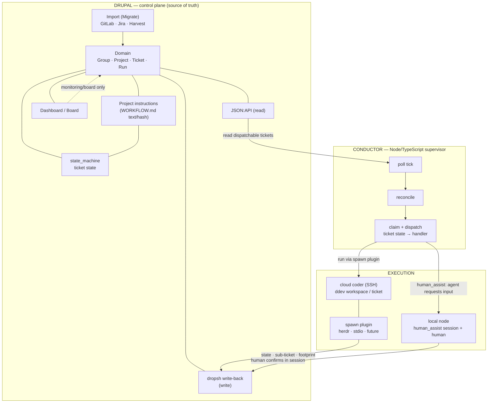

<p align="center">
  
</p>

<p align="center">
  <strong>A ticket-driven orchestrator where every active ticket state is worked by a human or an AI.</strong>
</p>

<p align="center">
  <a href="https://www.npmjs.com/package/@bakers-build/bakers"></a>
  
  
</p>

---

> Inspired by [OpenAI Symphony](https://github.com/openai/symphony), extended with a Drupal control-plane, distributed conductors, Delivery Point billing, and internal cost allocation.

Start with the [bakers.build manual](docs/index.md) for setup, configuration and AI-assisted ticket work.

## Start using bakers.build

bakers.build is a **standalone application**: a Drupal control plane, a CLI/conductor on your
machine and agent skills. It is not an installable module for arbitrary Drupal sites.

- [Connect your chat client](docs/get-started/connector.md): use an existing server and your own
  account; no developer machine setup is required.
- [Set up your machine](docs/get-started/machine.md), then [set up a project](docs/get-started/connect-a-project.md):
  install the CLI and skills, sign in and configure execution capacity.
- [Join a project](docs/get-started/first-ticket.md): use existing membership and team capacity
  without repeating project bootstrap.
- [Run the server](docs/configuration/project/server.md): operator prerequisites and deployment.
  Independent public installation remains subject to the [acceptance prerequisites and support matrix](docs/bakers/clean-install-acceptance.md).

For the CLI, use your selected candidate's exact package version and Node >=20.19:

```sh
npm install -g @bakers-build/bakers@<exact-version>
bakers --version
bakers init --base-url https://<your-server>
bakers auth login
bakers auth status
bakers config check --scope connection --online
```

`bakers init` configures machine identity and connection; project setup is a separate step. Follow
[machine setup](docs/get-started/machine.md) for the required skill installation and agent prerequisites.
A bare `next` tag, private cache or existing global install is not public candidate evidence.

To change the application, read [CONTRIBUTING](CONTRIBUTING.md), [SECURITY](SECURITY.md) and the
[clean-install runbook](docs/bakers/clean-install-acceptance.md). Repository tests require Node
>=22.22.0. Call a source build explicitly as `./bakers-cli/bin/bakers`; do not count it as the
published CLI.

## The idea in one paragraph

Coding agents are fast, but the bottleneck is human attention spent micro-managing many sessions.
bakers.build inverts that: **the issue tracker becomes the control plane.** Every active ticket has a
state; the state points at a handler. A registered **conductor** claims dispatchable tickets and
starts/attaches agents through spawn plugins. Human questions, approvals, and reviews run as
`human_assist` runs too: a local conductor prompts the human with context and the session writes
back after confirmation. A separate commercial and worklog context links to bakers.build Projects and
Tickets through one-way Domain Links. It owns Engagements, Delivery Items, Delivery Points,
Worklogs, and Billable Units; bakers.build execution entities never link back.

## Guiding principles

1. **Control-plane = single source of truth (Drupal).** Tickets/states live in Drupal.
2. **Repo workflow = instruction text.** The state machine (incl. handler/skill selection) is
   code-defined per ticket type; a repo `WORKFLOW.md` only adds project-specific working rules as
   text for sessions.
3. **The conductor claims + dispatches.** Concurrency (slot accounting), workspace, and executor
   selection — no probe/reconcile, no ticket-state writes. The agent session owns the run
   lifecycle (Model B); the crash backstop is the lease TTL.
4. **Agents are autonomous.** State transitions, comments, sub-tickets, footprint — and releasing
   their own run — are written back by the session itself via `BbRemote` (the dropsh lib).
5. **Model-agnostic.** The agent is swappable (Claude Code default, Codex, …), selectable per
   project/ticket/handler.
6. **Canonical domain model (Linear-style).** No foreign-system entities — imports normalise; the
   source system is only metadata.
7. **Ticket = unit of dispatch and delivery.** A `Run` is a concrete execution attempt with claim
   and audit. Billing uses the separate model defined in `07-billing.md`; no commercial fields or
   reverse links are added to bakers.build entities, and Runs are never persistent link targets.

## Handlers instead of roles

bakers.build no longer models fixed role entities. **State handlers are code state metadata** (per
ticket-type workflow) — skill/handler, role, mode, and capabilities. Each handler runs as a
spawned session via a spawn plugin: `ai_run` autonomously, `human_assist` requests human input.

| Handler | Purpose |
|---|---|
| `qualification` | classify the ticket and publish its qualification handoff, create sub-tickets if needed |
| `spec` | sharpen requirements |
| `code` | implement in the workspace |
| `review` | check and return/accept |
| `human_input` | human question/approval/decision via a `human_assist` run: the agent prompts, the human decides, the session writes back |

Concrete names are project-dependent. There is no separate HERMES orchestrator as a domain object.

## Component map



## Documentation

| File | Contents |
|---|---|
| [`07-billing.md`](docs/decisions/time-tracking-and-billing.md) | Separate commercial/worklog context, one-way Domain Links, Delivery Points, and Harvest boundary |

## Join this repository

Repository: `bakers-build/bakers-build`; bakers.build project: `bakers`. The committed `.bakers` configuration targets
the team's develop control plane. Obtain your own credentials and workspace access from the
operator; inspect the effective connection before running commands. Follow [join a project](docs/get-started/first-ticket.md)
and then `WORKFLOW.md`. A team conductor may supply execution capacity. Local test work uses
the playground set up by `scripts/setup-test-project.sh`.

## License

This repository holds components under different licenses, all © keytec GmbH unless noted:

- **Server** (Drupal modules, theme, recipes, configuration): GPL-2.0-or-later, see [`LICENSE.txt`](LICENSE.txt).
- **CLI** (`bakers-cli/`, the `@bakers-build/*` npm packages): MIT, see [`bakers-cli/LICENSE`](bakers-cli/LICENSE).
- **`bakers` plugin skills** (`.claude/skills/bakers-build/`): MIT, see its `LICENSE`.

Third-party material keeps its own license and notices. [Licensing](docs/bakers/licensing.md) maps every
shipped component to its source, license and evidence, and lists what is not yet cleared for publication.
