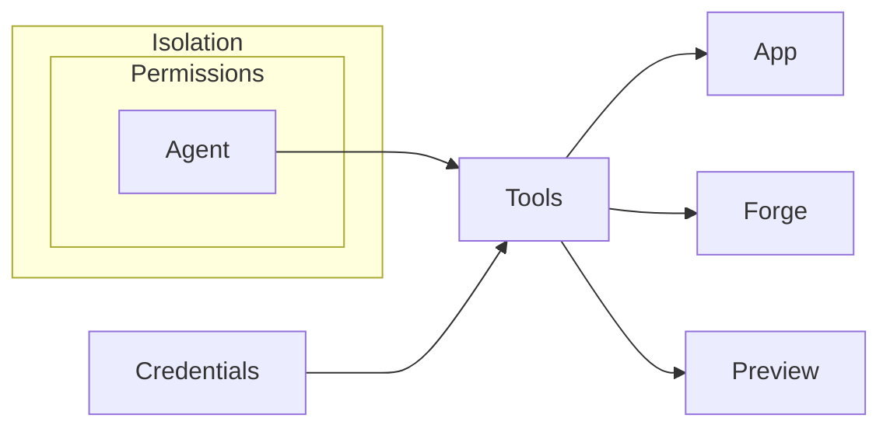

# Agent permissions and isolation

An agent runs commands on your machine. Three layers limit what it can reach: permissions, isolation and tools.

**Permissions** decide what the agent may do. **Isolation** decides what its process can see. **Tools** do the rest outside both, with credentials the agent never holds.

## What should I choose?

- **Your own machine, your own tickets:** `system`, the default. The agent uses your own harness settings.
- **A shared or remote worker:** `sandbox`, after its [prerequisites](/provision/security/execution#sandbox-prerequisites).
- **Stronger isolation:** the [Bubblewrap or Docker runtime](/agents/isolation). Both are **experimental** and run each agent in a fresh clone.

## Configure and verify

- `bakers agents` shows each agent's effective mode and rules.
- `bakers conductor check` checks the sandbox prerequisites on this host.

## Details

<DocTiles :tiles="[
  { title: 'Agent permissions', text: 'Modes, native sandbox prerequisites, read and write rules, network and MCP limits per harness.', link: '/provision/security/execution', icon: 'terminal', meta: 'Choose allowed actions →' },
  { title: 'Configure permissions', text: 'Share one permissions block across agents in machine and project config, and see what each harness applies.', link: '/provision/security/shared-settings', icon: 'settings', meta: 'Configure →' },
  { title: 'Isolation models', text: 'Compare sandboxes, runtimes, containers and VMs, with support by agent and platform and known limits.', link: '/agents/isolation', icon: 'layers', meta: 'Choose a boundary →' },
  { title: 'Tools and integrations', text: 'How the agent starts the app, runs checks, pushes and shares a preview without leaving its sandbox.', link: '/provision/tools', icon: 'plug', meta: 'Understand tools →' }
]" />

Also: [API keys and service accounts](/provision/security/credentials), [Access and data](/provision/security/access-and-data), [Write a runtime addon](/addons/build/runtime).

**Next:** [verify independent operation](/provision/guide#verify-independent-operation), then [run a ticket](/get-started/first-ticket).
