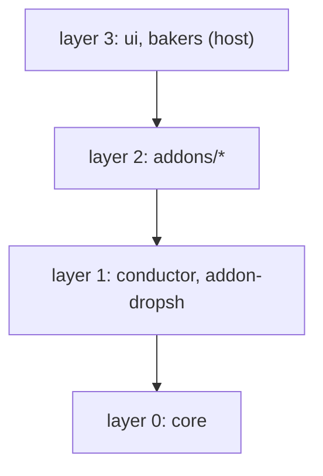

# Architecture

bakers.build has three parts with fixed boundaries: a Drupal control plane that owns tickets and runs, a conductor that claims work and starts agents, and the skills and `WORKFLOW.md` that tell each agent what to do; this page describes those boundaries and the package layering of the CLI as they are now.

## Control plane

The control plane is a Drupal application. Its code lives in `web/modules/custom/bb_core`, and it is the only authority for a ticket's state.

- **Entities.** Workspaces, teams, projects, tickets, comments, runs, conductors, machines, environments, measurements and the terms of the type, recipe and label vocabularies.
- **State machines.** They are defined in code, in `bb_core.workflows.yml`: one ticket workflow, `bb_work`, which every ticket runs, one for runs and one for reviews. The kind of work is ticket data: a type, a recipe and labels; a deployment is a ticket of type `deployment`, a verification one of type `verification`. A state marked `claimable` may be picked up by a conductor. `done` and `cancelled` are never claimable. [Workflows and states](/configuration/workflows/states) lists them.
- **Access.** Everything goes through the server's API, JSON:API and the named tools at `/mcp`, authenticated with OAuth. Agents, `bakers ui` and `bakers tools` all write through the server's API; nothing writes behind it.

### Claims

A claim is made by `TicketClaimService`, which rechecks eligibility on the server and mints a run in one atomic step. A ticket is eligible when:

- the conductor is active, its project matches the ticket's, and the ticket's state is claimable, inside the conductor's optional list of served states;
- the ticket is assigned to that conductor. A ticket with no workflow yet is the exception: any conductor of the project may claim it to qualify it;
- it has no open blockers and no active run, and repeated failed runs have not parked it;
- it is not frozen;
- the machine is under its `max_parallel`, counted from the live runs of every conductor linked to that machine.

A run is both one attempt at one ticket state and the lease on that ticket. The lease is 300 seconds by default and at most 3,600, and a run that was claimed but never started expires, which makes the ticket claimable again. Run states are `claimed`, `running`, `done`, `expired`, `failed` and `cancelled`.

A run ends on the server. When the ticket moves to its next state, the server closes the run that executed the previous state, and a ticket that enters `done` or `cancelled` closes its last run. No client command releases a run.

A run is cancelled in three ways, each setting the existing state `cancelled`; the tool and a conductor change also append the cause to the run's error log:

- *Cancel run* on the ticket page or in the terminal UI;
- the `bakers_run_cancel` tool (`ticket`, `reason`), which cancels all of the ticket's `claimed` and `running` runs under the same rule as *Cancel run* (ticket edit access), all or none, and logs `cancelled by <account>: <reason>`; an agent passes its own ticket to stop its run;
- a change of the ticket's conductor, including clearing it: every run still `claimed` or `running` on another conductor is cancelled with `conductor reassigned`, and the new conductor claims the ticket on its next tick. A save that keeps the conductor cancels nothing.

Cancelled runs never count toward the failed-run circuit breaker.

## Conductor

The conductor is the claim-and-dispatch loop that `bakers oven start` runs, in `@bakers-build/conductor`. One conductor serves one project checkout, and the control plane coordinates them; there is no central daemon. Each tick does the following.

1. Send a heartbeat, which refreshes the registration and recomputes the machine's load.
2. Read the machine's shared capacity.
3. Finalise runs the server has closed (`done`) or cancelled: stop the agent, store the transcript, compute the effort metrics, close the hosted session. The run keeps its state, and the `run finalised` log names it.
4. Reap the worktrees of finished tickets.
5. Claim one ticket at a time while the machine has capacity, and dispatch each claim: resolve the agent, ensure the workspace, start the session and mark the run `running`. A failed dispatch marks the run `failed` with the error.

The conductor does not decide implementation, does not write a ticket's state and does not create tickets. The agent does those through the API.

Four typed slots connect the loop to the outside world. The loop depends on the interfaces, never on an implementation, and each slot is filled by an addon.

| Slot | Interface | What it does | Shipped addon |
|---|---|---|---|
| remote | `BbRemote` | Register, heartbeat, claim, read tickets, update runs, finalise | `addon-remote-drupal` |
| executor | `BbExecutor` | Start, stop and clean up a run, run hooks | `addon-herdr` |
| workspace | `BbWorkspace` | Ensure the ticket's git worktree | `addon-herdr` (paired) or `addon-workspace-git` |
| agent | `BbAgent` | Launch command, read the transcript, parse the footprint | `addon-claude`, `addon-codex`, `addon-grok`, `addon-kimi`, `addon-opencode`, `addon-pi` |

The agent for a ticket comes from its `agent:` labels first, then the machine's `default` route and default agent. The conductor composes three inputs: the machine file, which owns identity, capacity and the agent catalog; the project's `.bakers/conductor.config.js`, which owns the wiring; and a connection, which is loaded separately and names the server and the sign-in. [Which file owns what](/configuration/) and [conductor configuration](/configuration/project) describe each.

## Skills and `WORKFLOW.md`

The state machine lives in code. Skills and `WORKFLOW.md` hold the instructions for an agent working one state, and the control plane never parses them. A run executes one state: the owning skill does the work, publishes a handoff and a summary, writes the next state, and stops. [The skill contract](/configuration/project/contributing#skill-contract) states the rules.

## CLI package layering

The CLI is one workspace, `bakers-cli/`, of acyclic packages in four layers. A package may depend only on the layers below it.



| Layer | Packages | Rule |
|---|---|---|
| 0, kernel | `@bakers-build/core` | No `@bakers-build/*` dependency at all |
| 1 | `@bakers-build/conductor`, `@bakers-build/addon-dropsh` | Depend on `core` and nothing else |
| 2, addons | every package under `addons/` | Depend on `core`, `conductor` and `addon-dropsh`, plus a short list of named siblings |
| 3, sinks | `@bakers-build/ui`, `@bakers-build/bakers` | May depend on anything; nothing depends on `@bakers-build/bakers` |

What each package owns:

- **`core`** holds the surface-agnostic kernel: configuration loading and path resolution, addon discovery, logging and small utilities.
- **`conductor`** holds the run engine, the `conductor` command and the conductor contract, exposed to addons as `@bakers-build/conductor/contract`. The contract lives here, not in `core`, so the kernel stays free of engine types.
- **`addons/*`** hold every mountable capability, one package each. [Addon contracts](/addons/build/contracts) describes them.
- **`ui`** is the `bakers ui` command. It is an application, not an addon, so it may depend on addons.
- **`host`**, published as `@bakers-build/bakers`, is the `bakers` binary. It registers `version`, `config`, `init` and `update` itself, and builds the rest of its command list from the light presets of the command addons. A command's module is imported only when that command runs, so `bakers --help` imports none of them. The environment variable `BB_COMMANDS`, a JSON array of command descriptors, replaces the whole list.

The guard `bakers-cli/scripts/assert-acyclic.mjs` enforces this and fails with the offending edge. It checks that:

- the graph has no cycle, `core` has no `@bakers-ai` dependency, and no package depends on `@bakers-build/bakers`;
- an addon's `@bakers-ai` dependencies stay inside its allowance, and an addon never depends on a sink;
- an addon declares its contract packages as peer dependencies, never as plain dependencies, so the host provides the single shared copy;
- an addon that contributes to the conductor surface peers `@bakers-build/conductor`, and one that contributes cockpit tabs peers `@bakers-build/addon-bakers-ui`;
- the layer 1 packages depend on `core` only.

The named sibling edges are `herdr` to `workspace-git`, `essentials` to `name-refs`, and `bakers-ui-artifacts` to `bakers-ui`. Adding another needs an edit to the guard, which is the point: a new edge is a decision.

```sh
cd bakers-cli
node scripts/assert-acyclic.mjs
pnpm exec vitest run host/tests/acyclic.test.ts
```

The first command prints `assert-acyclic: OK` with the package counts; the second is the test that runs it in CI.
