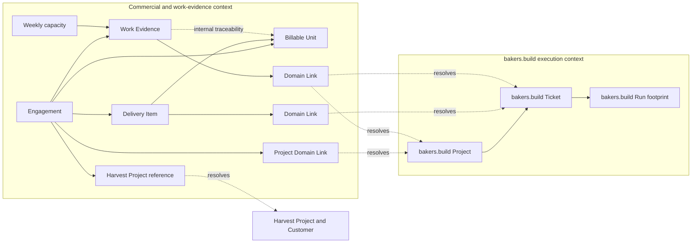

# 07 — Delivery Points, Work Evidence, and Billing

- **Status:** Approved target concept; ready for implementation planning
- **Decision date:** 2026-08-12
- **Audience:** bakers.build users, project managers, finance stakeholders, and implementation agents
- **Authority:** This document is the single source of truth for bakers.build billing semantics. Older
  references to invoicing Run duration, tokens, `time_spent`, or a retired `bb_time_entry`
  entity are historical and do not define the target model.

## Executive Summary

AI-assisted delivery breaks conventional time tracking. One employee can supervise many tickets in
parallel, while autonomous Runs continue without continuous human attention. Run duration, token
usage, and prompt counts are useful evidence, but none of them is actual employee time and none of
them is a customer price.

bakers.build therefore separates two independent streams:

```text
Runs + calendar + weekly capacity
                |
                v
          Work Evidence
     internal hours and costs only

Linked bakers.build Ticket + Delivery Item LP
                |
                v
           Billable Unit
                |
                v
        External billing system
```

A **Delivery Point (LP)** is the conventional software effort bakers.build estimates would have been needed
to deliver the scoped work without generative AI execution. It is a commercial sizing unit, not a
measurement of elapsed or employee time. Actual employee effort remains denominated in hours and is
used only for internal cost allocation.

In the first integration phase, Harvest remains the external billing system. bakers.build sends approved
Billable Units and their LP quantity; Harvest owns rates, prices, invoices, and the final billed
state. The exact translation from LP into Harvest's time-shaped input is an adapter concern and is
deliberately deferred until the team has enough operating experience.

## Problem Statement

The current time-based model has four structural problems:

1. Employees work across five to ten AI-assisted tickets in parallel, so manual per-ticket timers
   are burdensome and routinely inaccurate.
2. Run wall-clock duration includes idle time, transcripts may be missing, and telemetry semantics
   differ by agent. Run footprints cannot be treated as invoice-safe working time.
3. A bakers.build Project is an execution context, not necessarily a customer contract. One technical
   Project can contain internal work, fixed-scope work, and individually priced customer work.
4. Meetings, project management, reviews, and other human activity create company cost but do not
   naturally fit a model in which every Run or Ticket is billed by actual hours.

The team needs a model that preserves pricing continuity with an hourly billing system while making
AI productivity visible, removing daily timer selection, and retaining a plausible internal cost
view.

## Solution

bakers.build introduces five canonical commercial concepts and one employee profile:

1. **Engagement** — the commercial context corresponding initially to a Harvest Project.
2. **Delivery Item** — the commercial representation of customer-visible scope and its LP value.
3. **Work Evidence** — an employee's measured or inferred internal effort allocation.
4. **Billable Unit** — an approved bundle of Delivery Items with an immutable LP
   snapshot.
5. **Domain Link** — a one-way, new-context-owned reference to a bakers.build Project or Ticket.
6. **Employee capacity and cost profile** — the effective weekly capacity and internal cost basis
   used to turn approved Work Evidence into company cost.

Tickets remain part of the bakers.build execution model and are not extended with commercial fields.
Delivery Items link to Tickets, but a Ticket never links back to an Engagement,
Delivery Item, Work Evidence, or Billable Unit. Runs remain execution/audit records. Neither Runs
nor Work Evidence directly determine customer price.

## Ubiquitous Language

Use these terms consistently in UI copy, APIs, documentation, and agent instructions.

| Term | Definition |
|---|---|
| **Delivery Point (LP)** | One unit of conventional software effort estimated for a competent, project-familiar professional using normal non-generative tools. One LP is anchored to one conventional reference hour, but is not an actual worked hour. |
| **Employee hour** | Actual or plausibly allocated human effort, stored as internal duration and never exported as the customer quantity in phase one. |
| **Engagement** | A commercial context with one billing mode and one Harvest Project link. Customer identity remains owned by Harvest in phase one. |
| **Delivery Item** | Commercial scope carrying LP and the role `unit`, `container`, or `evidence`. It links to a bakers.build Ticket, whose existing source identity resolves the customer Source Ticket. |
| **Work Evidence** | A measured, derived, or manually adjusted allocation of an employee's capacity to a linked bakers.build Project and optionally a linked bakers.build Ticket. |
| **Billable Unit** | A commercial bundle of one or more Delivery Items whose LP values are snapshotted for export. |
| **Domain Link** | A commercial-owned, typed reference to a bakers.build Project or Ticket. It is resolved by an adapter and creates no reverse reference on the target. Runs are never link targets. |
| **Source Ticket** | The issue in the customer's source system that defines the customer-visible delivery and acceptance boundary. |
| **Commercial role** | A Delivery Item's role: `unit`, `container`, or `evidence`. |
| **Run footprint** | Machine telemetry such as tokens, duration, turns, tool calls, and prompts. It is evidence for allocation and AI cost, not employee time or customer price. |
| **Weekly capacity** | The employee's allocatable hours for a week after effective schedule and availability adjustments. |

The system must not label LP as actual time, label Run duration as employee time, or label inferred
Work Evidence as measured time.

## Domain Model



All cross-context arrows originate in the commercial and work-evidence context. No bakers.build execution
entity stores a reverse relationship to any of the new entities. bakers.build Run data may be read while
deriving a proposal through its Ticket, but no Domain Link ever targets a Run.

### Engagement

An Engagement is separate from a bakers.build Project. It may link to one or more Projects, and a Project
may be linked from multiple Engagements. The link exists only in the commercial context. The bakers.build
Project does not store an Engagement relationship.

Phase one supports these billing modes:

| Mode | Meaning |
|---|---|
| `unit_price` | Accepted commercial units contribute LP for external billing. |
| `fixed_scope` | Harvest owns the fixed fee. LP and Work Evidence describe delivered scope, progress, productivity, and internal cost. |
| `internal` | Work is costed internally and never exported for customer billing. |

One Engagement has one billing mode. Different commercial rules require a different Engagement,
even when the work shares a bakers.build Project.

An Engagement owns an external billing-system reference to its Harvest Project. The customer is
resolved through that Harvest Project. Prices, rates, currencies, taxes, and invoice documents
remain in Harvest during phase one.

### Delivery Item

A Delivery Item is the commercial shadow of customer-visible scope. It contains:

- Engagement within the commercial context
- a required Domain Link to the related bakers.build Ticket; the Ticket's existing source identity resolves
  the deterministic customer Source Ticket
- commercial role: `unit`, `container`, or `evidence`
- non-negative LP value
- LP accounting mode for a hierarchy: direct value or child roll-up

No commercial field is added to the linked bakers.build Ticket. The LP value is set on the Delivery Item
during qualification. Phase one stores one current LP value; it does not model separate estimated,
agreed, and final LP values. The value can be corrected until it is copied into an approved Billable
Unit. A later implementation may add LP versioning after real usage provides enough evidence for
useful rules.

Commercial roles have these meanings:

- `unit` — creates a Billable Unit candidate after customer acceptance.
- `container` — groups subordinate delivery, such as an Epic in a fixed-scope Engagement.
- `evidence` — proves delivery inside a container but does not independently create customer
  price.

Internal child Tickets without their own Source Ticket are execution details. They may be linked as
evidence to an existing Delivery Item but do not require an independent Delivery Item or Billable
Unit.

### Work Evidence

The delivered personal-time slice is a narrow exception to this wider commercial
concept: evidence directly references its project, optional ticket and work-owned
booking target; it has no Engagement, rates or reverse execution-entity fields.
The personal weekday schedule is a single user field for AI planning.
The AI handles absence, weighting, rounding and distribution and submits concrete
whole-minute durations. bakers.build validates and stores them directly as recorded evidence,
without a server-side allocator, date exceptions, template/cap enforcement or a
weekly approval workflow. A week is only a date filter. Legacy approved rows remain
read-only, and retired weekly history remains in storage. This delivered behavior
supersedes the server-allocation and weekly-approval assumptions in the broader future concept below.
AI adapters submit attributable activities; bakers.build does not fetch calendars or export
to Harvest in this slice. See [Record time](../get-started/daily-work/record-time.md).

Work Evidence is internal. It answers: "What did this employee plausibly spend their available
working capacity on, and what did that allocation cost the company?"

Each Work Evidence record contains, conceptually:

- employee
- allocation period
- allocated duration
- required Domain Link to a bakers.build Project and optional Domain Link to a bakers.build Ticket
- resolved Engagement
- derivation: `measured`, `derived`, or `manual`
- confidence
- an explanation of the source signals used, such as calendar data, prompts, reviews, or aggregated
  Run and Ticket activity
- state: `suggested`, `recorded`, or `approved`
- effective employee cost snapshot or a stable reference to it

A calendar meeting creates measured Work Evidence for each participating employee. Meetings and
project-management work must be assigned to a Project and may be assigned or split across Tickets.
When a reliable Ticket split is unavailable, the evidence remains linked at Project level.

Run counts and tokens may contribute weak allocation signals by being read through the relevant
Ticket. They do not create Domain Links to Runs. Human interactions such as prompts, reviews,
corrections, and Ticket switches are stronger signals for human attention. Autonomous Run duration
must not be used as employee duration.

### Billable Unit

A Billable Unit is always its own entity. It is not a subtype of Ticket or Meeting.

Each Billable Unit contains, conceptually:

- Engagement and billing period
- state: `proposed`, `approved`, or `billed`
- one or more component Delivery Items
- an immutable LP snapshot per component Delivery Item
- LP total derived from the component snapshots
- optional links to relevant approved Work Evidence for internal traceability
- external billing-system reference
- billed timestamp
- optional reference to an earlier Billable Unit when it is a correction

For a normal Billable Unit, total LP is the sum of component Delivery Item LP. Phase one has no
bundle multiplier, discount, leverage, or independent total override. If the sum is wrong, the
Delivery Item LP must be corrected before approval.

A billed Billable Unit is immutable. A later correction is represented by a positive or negative
correction unit referencing the original; the original record remains locked.

### Employee capacity and cost profile

Each employee has an effective weekly capacity used as the allocation pool. Holidays, absence,
part-time schedule changes, and approved overtime adjust that pool. Contract hours alone must not
silently become customer work.

An effective internal cost profile converts approved employee duration into company cost. Employee
duration and currency cost remain separate values. Historical cost reports use the cost basis that
was effective for the evidence period, rather than today's employee rate.

Cost profiles are sensitive financial data and require narrower access than ordinary Ticket and
Work Evidence data.

### AI cost

AI cost is separate from employee duration. It is derived from provider/model usage on Runs when
the available telemetry is sufficient. Missing model or token-bucket detail yields an unknown cost,
not a fabricated zero. AI cost may be aggregated transiently through linked Tickets into Delivery
Items and Engagements for internal profitability analysis, but no persistent Run link is created
and AI cost never becomes human time.

## Domain Invariants

1. LP and employee hours are different dimensions and are never copied into each other inside the
   canonical domain.
2. Run duration and token usage never directly determine a customer quantity.
3. bakers.build execution entities never store references to Engagement, Delivery Item, Work Evidence,
   Billable Unit, or Domain Link.
4. Every persistent cross-context association to bakers.build is a Domain Link owned by the commercial and
   work-evidence context.
5. A Domain Link may target a bakers.build Project or Ticket, never a Run.
6. Every Delivery Item belongs to exactly one Engagement.
7. Every Engagement has exactly one billing mode.
8. Different billing rules require different Engagements.
9. Every Work Evidence record belongs to one employee, one period, one resolved Engagement, and one
   linked bakers.build Project; a bakers.build Ticket link is optional.
10. Approved Work Evidence for an employee and week cannot exceed adjusted weekly capacity unless
   explicit approved overtime expands the pool.
11. Measured meetings are allocated before the residual weekly capacity is distributed across Run
   and Ticket signals.
12. Unexplained residual time remains internal or unassigned; it is not forced onto customer work.
13. Customer acceptance is read from the Source Ticket identity resolved through the linked bakers.build
    Ticket, not inferred from internal child
    completion.
14. A `unit_price` Delivery Item is billed at most once unless an explicit correction unit exists.
15. A Delivery Item hierarchy records LP at one accounting level: a container owns direct LP or
    rolls up child LP, never both.
16. An approved Billable Unit snapshots its component Delivery Item LP values.
17. A billed Billable Unit and its component snapshots are immutable.
18. Work Evidence does not increase or decrease LP automatically.
19. Phase-one exports contain commercial LP quantities, not internal employee hours.
20. An `internal` Engagement never produces a customer export.

## Workflows

### 1. Qualification and LP sizing

1. bakers.build identifies or imports a Ticket with a deterministic customer source identity.
2. Qualification creates or finds a Delivery Item in the separate commercial context.
3. The Delivery Item receives a Domain Link to the bakers.build Ticket and belongs to an Engagement.
4. Qualification assigns the Delivery Item's commercial role.
5. For a commercial `unit`, the qualifier estimates conventional effort without generative AI and
   records LP on the Delivery Item.
6. Internal child Tickets may be created for execution without receiving independent Delivery Items
   or LP.
7. A container Delivery Item chooses direct LP or child roll-up before any Billable Unit can be
   approved.

The reference estimator is a competent professional familiar with the Project, using normal
non-generative development tools. LP estimates are calibrated from historical work over time; they
must not vary by whichever individual happens to qualify the Ticket.

### 2. Weekly internal allocation

1. bakers.build determines each employee's adjusted capacity pool for the week.
2. Calendar meetings and other measured events create proposed Work Evidence and consume capacity
   first.
3. Bb analyzes the remaining human interaction signals from Runs and Tickets without persisting
   Run links.
4. Bb proposes allocation of the remaining capacity across Tickets, Projects, and internal work.
5. Low-confidence or ambiguous allocations are highlighted rather than hidden.
6. The employee reviews and corrects the proposal.
7. Employee approval freezes the evidence used for internal cost reporting.

This is exception-oriented reconciliation, not manual start/stop time tracking. The employee
confirms a weekly distribution instead of selecting the correct timer throughout the day.

### 3. Customer acceptance and monthly billing

1. Internal child Tickets may complete without creating a billing candidate.
2. The customer accepts the Source Ticket in the customer system.
3. bakers.build resolves the linked Ticket's source identity and recognizes the corresponding Delivery Item
   with role `unit` as eligible.
4. At period close, bakers.build proposes Billable Units grouped by Engagement and billing period.
5. Each proposal snapshots the included Delivery Item LP values and links relevant approved Work
   Evidence for internal explanation.
6. A project manager reviews the scope, composition, and LP sum.
7. Project-manager approval makes the unit exportable.
8. The external adapter exports the Billable Unit idempotently.
9. Harvest owns rates, invoice creation, and invoice status.
10. When Harvest reports the work as billed, bakers.build marks the Billable Unit `billed` and locks it.

Phase one does not partially bill unfinished Tickets. Internal Work Evidence can accumulate across
periods; LP is exported only after the customer accepts the Source Ticket.

### 4. Fixed-scope Engagement

An Epic is commonly represented by a `container` Delivery Item for a fixed-scope Engagement or
milestone. Delivery Items linked to bakers.build Tickets representing child Source Tickets use role
`evidence`. Customer acceptance of those Source Tickets records delivery progress and supports
internal cost analysis, but does not create additional ticket prices. Harvest remains the source of
truth for the fixed fee and invoice schedule.

LP is still recorded for fixed-scope delivery because it provides a stable conventional-size
baseline. Comparing delivered LP with internal employee and AI cost makes fixed-price profitability
and future estimation quality visible.

### 5. Corrections

Before export, a proposed Billable Unit can be rebuilt from corrected Delivery Item LP or
composition. After Harvest marks a unit billed, its state and snapshots remain unchanged. A
correction creates a new signed Billable Unit that references the original and enters the normal
approval/export flow.

## User Stories

1. As a project manager, I want each Delivery Item assigned to an Engagement and linked to its bakers.build
   Ticket, so that execution Projects can contain work governed by different contracts without
   gaining commercial fields.
2. As a project manager, I want an Engagement to have one billing mode, so that every exported unit
   follows a coherent commercial rule.
3. As a project manager, I want different rules represented by different Engagements, so that
   exceptions do not become hidden in bakers.build Ticket pricing fields.
4. As a qualifier, I want to estimate a Delivery Item in LP, so that AI-assisted work has a stable
   conventional-effort baseline without modifying the linked Ticket.
5. As a qualifier, I want the LP definition available at the point of estimation, so that estimates
   are comparable across people and Projects.
6. As a qualifier, I want to mark a Delivery Item as a unit, container, or evidence, so that
   acceptance and billing behavior are unambiguous.
7. As an implementation agent, I want internal child Tickets excluded from independent Delivery
   Items by default, so that decomposition cannot create accidental revenue duplication.
8. As a project manager, I want a container Delivery Item to use direct LP or child roll-up, so that
   hierarchy totals cannot double count effort.
9. As an employee, I want Bb to propose my weekly work distribution, so that I do not manually
   choose a timer while supervising parallel AI work.
10. As an employee, I want calendar meetings included automatically, so that known human effort is
    not reconstructed from weak Run signals.
11. As an employee, I want meetings assigned through Domain Links to a bakers.build Project and optionally
    split across linked Tickets, so that project-management cost reaches the correct context.
12. As an employee, I want Bb to show how a proposed allocation was derived, so that I can judge
    it without reverse-engineering the model.
13. As an employee, I want low-confidence allocations highlighted, so that my attention is spent on
    ambiguous cases rather than routine confirmation.
14. As an employee, I want residual capacity assignable to internal or unassigned work, so that
    every paid hour is not falsely charged to a customer Project.
15. As an employee, I want to approve or correct my own Work Evidence, so that internal cost reports
    carry human accountability.
16. As a finance stakeholder, I want historical Work Evidence valued with the effective cost basis,
    so that later salary changes do not rewrite historical project cost.
17. As a finance stakeholder, I want employee cost access restricted, so that sensitive compensation
    data is not exposed through ordinary project access.
18. As a finance stakeholder, I want AI cost reported separately from employee cost, so that I can
    understand the delivery cost structure.
19. As a finance stakeholder, I want unknown AI cost shown as unknown, so that missing telemetry is
    not reported as zero cost.
20. As a project manager, I want customer acceptance resolved through the Delivery Item's linked
    bakers.build Ticket to trigger billing eligibility, so that internal completion is not mistaken for an
    accepted deliverable.
21. As a project manager, I want Bb to propose monthly Billable Units, so that period close starts
    from a complete candidate list.
22. As a project manager, I want a Billable Unit to bundle multiple Delivery Items, so that the
    exported position can match the commercial narrative.
23. As a project manager, I want component LP snapshotted at approval, so that later Delivery Item
    edits do not change an already reviewed period.
24. As a project manager, I want the bundle total derived from component Delivery Item LP, so that
    phase-one pricing has no hidden multipliers.
25. As a project manager, I want approved Work Evidence linked for internal explanation, so that I
    can assess profitability without sending employee hours to the customer.
26. As a billing operator, I want only approved Billable Units exported, so that employee approval
    and commercial approval remain separate responsibilities.
27. As a billing operator, I want every export idempotently keyed to its bakers.build Billable Unit, so that
    retries cannot create duplicate Harvest entries.
28. As a billing operator, I want Harvest's billed state synchronized to Bb, so that already
    invoiced work is visibly locked.
29. As a billing operator, I want billed units immutable, so that invoice history remains auditable.
30. As a billing operator, I want corrections represented as linked adjustment units, so that errors
    can be fixed without rewriting history.
31. As a fixed-scope project manager, I want a container Delivery Item linked to an Epic to contain
    delivery evidence, so that progress and internal cost are visible without creating extra
    customer charges.
32. As a delivery lead, I want to compare LP with internal human and AI cost, so that AI productivity
    and fixed-price profitability can be evaluated.
33. As a colleague reviewing the model, I want customer quantity and employee duration visibly
    separated, so that no report silently equates LP with worked hours.
34. As a future implementation agent, I want the canonical terms and invariants in one document, so
    that implementation does not revive the retired Run-time billing model.
35. As a bakers.build maintainer, I want execution entities to have no commercial back-references, so that
    the new domain can evolve or move to another service without changing the bakers.build entity model.

## Implementation Decisions

### Bounded contexts and ownership

- The canonical commercial and work-evidence model is a separate bounded context. It must not be
  implemented as fields or map values on bakers.build execution entities.
- Engagement, Delivery Item, Work Evidence, Billable Unit, and Domain Link are first-class entities
  in the new context.
- New-context entities may reference each other directly. Cross-context relationships to bakers.build use
  only commercial-owned Domain Links.
- bakers.build entities never reference the new entities. This dependency direction is a hard invariant,
  not a UI convention.
- Harvest owns the customer relationship in phase one.
- Run owns machine execution/audit telemetry. Human allocation is not added to Run.
- The external billing adapter owns Harvest-specific resource shapes and translation.

### Existing-field compatibility

- Existing `time_estimate` and `time_spent` Ticket fields retain their historical seconds semantics
  until a separate migration removes or retires them. LP is stored on Delivery Item and must not
  repurpose a Ticket time field.
- The retired `bb_time_entry` entity is not restored as a Run-footprint ledger. Work Evidence is a
  new business concept with employee, period, allocation, derivation, and approval semantics.
- Existing Ticket source identity may be read through a Domain Link to determine customer
  acceptance; it is not copied into a reverse commercial field on Ticket.
- Existing Run footprint metrics remain observations. The allocation service may read them by
  traversing from a linked Ticket, but Work Evidence never stores a Run link.

### First-stage manual Worklog

The first shipped slice does not implement the target model above. It does not replace it.

- Module `bb_track` stores one `Worklog` content entity (`bb_track_worklog`) per recorded
  interval, plus a `Submission` content entity (`bb_track_submission`) grouping one owner's
  worklogs for a week or an AI proposal.
- Project is a required entity reference and ticket is an optional entity reference on that
  entity. The customer or internal organization is the selected project's current group. Hours
  follow that group if the project is regrouped; a missing or inaccessible project or ticket
  shows as unresolved without disclosing its metadata, and the worklog and its duration are kept.
  The owner is the Drupal user who saved the row. Worklog stores no workspace of its own.
  Engagement, first-class Domain Link, Billable Unit, and the remaining commercial entities stay
  deferred. This is the authorized write path until those entities exist.

### Numeric semantics

- LP is stored as an exact, non-negative decimal rather than binary floating point. Phase one should
  support fractional LP without prescribing a Fibonacci scale.
- Employee duration is stored in a canonical duration unit and rendered as hours to humans.
- Currency cost uses exact decimal arithmetic and an explicit currency.
- Missing LP, missing duration, unknown AI cost, and numeric zero are distinct states.

### Relationships and snapshots

- A Domain Link stores its owning new-context entity, target type (`project` or `ticket`), stable
  bakers.build identifier, and semantic role. It does not require a reciprocal field or cross-context
  database foreign key.
- A missing or deleted target makes a Domain Link unresolved and visible for reconciliation; it
  does not cascade-delete commercial history.
- An Engagement may have Project links. A Delivery Item has a Ticket link. Work Evidence has one
  Project link and zero or one Ticket link.
- Runs are never Domain Link targets. Run observations are queried transiently through Ticket scope.
- A Delivery Item has one Engagement relationship within the new context.
- A Work Evidence record has one employee, one period, one Engagement, one Project link, and zero or
  one Ticket link. A split meeting creates separate allocations rather than a multi-target duration
  whose arithmetic is implicit.
- A Billable Unit has component records pairing each Delivery Item with its LP snapshot.
- Billable Unit total is derived from component snapshots and validated at every write.
- Correction units carry a signed delta and a reference to the billed original.

### State and permissions

- Work Evidence states are `suggested`, `recorded`, and `approved`. Employees approve their own evidence; project
  managers may correct through an explicit audited path.
- Billable Unit states are `proposed`, `approved`, and `billed`.
- Project managers approve commercial units. Employees do not approve customer billing.
- Only the external billing synchronization marks an approved unit billed.
- Billed entities reject mutation outside correction creation.
- Employee cost profiles are visible only to explicitly authorized finance roles and services.

### Source-system acceptance

- The commercial context resolves external source identity through the Delivery Item's linked bakers.build
  Ticket. The source identity remains deterministic across repeated synchronization.
- Source acceptance is an explicit adapter result. A local `done` state alone is insufficient.
- `unit_price` Delivery Items with role `unit` become candidates after acceptance.
- Fixed-scope containers use accepted evidence to express progress; they do not create per-Ticket
  price.

### Harvest phase-one boundary

- Bb exports approved Billable Units and commercial LP quantity only.
- Bb does not export internal Work Evidence as customer time.
- Harvest owns project rates, fixed fees, currency, invoice generation, and invoice status.
- Export uses a stable external reference derived from the Billable Unit identity.
- The LP-to-Harvest quantity mapping, future leverage factor, and customer-facing wording remain
  adapter policy and are not encoded in the canonical phase-one domain.

### Service seams

The design needs two high-level behavioral seams because weekly allocation and monthly commercial
close are independent workflows with different actors and permissions:

1. A **work-allocation seam** accepts employee capacity and observed signals, then produces an
   explainable proposed allocation that can be approved.
2. A **billing-close seam** selects accepted Delivery Items, creates idempotent Billable Unit
   proposals, snapshots LP, approves export, and applies billed synchronization or corrections.

Harvest and calendar integrations remain ports behind these seams. Tests should exercise the
domain through the seams rather than directly testing helper arithmetic or storage callbacks.

## Acceptance Criteria

1. Given a Ticket under qualification, when it is classified as commercial work, then a separate
   Delivery Item links to it and owns the Engagement, role, and LP; the Ticket schema is unchanged.
2. Given a Project with two billing rules, when its work is qualified, then two Engagements can own
   links to the same Project without the Project referencing either Engagement.
3. Given a Delivery Item hierarchy, when a container uses child roll-up, then direct container LP is
   rejected.
4. Given an internal child Ticket without a Source Ticket, when it completes, then no Billable Unit
   candidate is created for it.
5. Given a Delivery Item linked to an unaccepted Source Ticket through bakers.build, when its internal
   children finish, then it remains ineligible for billing.
6. Given an accepted Source Ticket and its linked `unit` Delivery Item, when billing eligibility is
   evaluated, then exactly one unbilled candidate exists for its commercial scope.
7. Given an employee's adjusted weekly capacity, when measured meetings are applied, then they
   consume capacity before residual allocation.
8. Given an autonomous Run with long idle duration, when employee allocation is proposed, then idle
   Run duration is not treated as employee duration.
9. Given multiple parallel Ticket interactions, when allocation is proposed, then the proposal
   includes its signal basis and confidence.
10. Given unexplained weekly capacity, when allocation is completed, then the residual can remain
    internal or unassigned.
11. Given an employee correction, when Work Evidence is approved, then the approved total does not
    exceed adjusted capacity without explicit overtime.
12. Given a meeting covering multiple Tickets, when it is allocated, then the component durations
    add to the meeting duration without duplication.
13. Given an approved Work Evidence period, when the employee cost profile later changes, then the
    historical reported cost remains stable.
14. Given insufficient Run pricing telemetry, when AI cost is reported, then it is unknown rather
    than zero.
15. Given multiple eligible Delivery Items in one Engagement, when period close runs, then Bb can
    propose one bundled Billable Unit with component LP snapshots.
16. Given a proposed bundle, when one Delivery Item LP changes before approval, then rebuilding the
    proposal uses the corrected value.
17. Given an approved bundle, when its component Delivery Item LP changes, then the approved
    snapshots and total remain unchanged.
18. Given an approved Billable Unit, when export is retried, then the same external reference is used
    and no duplicate commercial entry is created.
19. Given an external billed response, when synchronization runs, then the Billable Unit becomes
    billed and rejects later mutation.
20. Given a billed unit with an error, when a correction is requested, then a linked signed
    correction unit is created and the original remains unchanged.
21. Given a fixed-scope container Delivery Item linked to an Epic, when an evidence item is accepted,
    then delivery progress and cost update without creating an additional unit-price charge.
22. Given an internal Engagement, when monthly close runs, then no customer export is produced.
23. Given a report comparing delivery size and cost, when it loads, then LP, employee hours, employee
    cost, and AI cost remain separately labeled dimensions.
24. Given a phase-one Harvest export, when its payload is assembled, then it contains approved
    commercial quantity and excludes employee Work Evidence duration.
25. Given any bakers.build execution-entity schema, when the new context is installed, then no field or
    reverse relationship to a new-context entity is added.
26. Given a Work Evidence proposal derived partly from Run telemetry, when it is stored, then it has
    Project/Ticket Domain Links and explanatory signal data but no Run Domain Link.
27. Given a Domain Link whose bakers.build target is unavailable, when commercial history is read, then the
    link is reported unresolved and the commercial record is retained.

## Testing Decisions

Good tests assert observable domain behavior at the highest available seam. They should validate
state changes, totals, permissions, idempotency, and exported contracts without asserting entity
storage callbacks, private helper methods, or a particular allocation algorithm.

### Domain and schema tests

- Kernel tests cover entity definitions, required relationships, exact numeric semantics, state
  transitions, immutability, hierarchy rules, capacity totals, and cost snapshots.
- Schema tests prove that no bakers.build execution entity references a new-context entity and that Domain
  Links reject Run targets.
- Domain Link tests cover resolution, unresolved targets, stable identity, and the absence of
  cross-context cascade deletion.
- Existing entity-schema and Ticket-workflow kernel tests are the closest prior art.
- Property-style cases cover split allocations, LP roll-ups, signed corrections, and total
  invariants across arbitrary component counts.

### Workflow tests

- Work-allocation integration tests start with capacity plus calendar/Run/Ticket signals and assert
  the complete explainable proposal, Project/Ticket links, absence of Run links, and approval result.
- Billing-close integration tests start with Source Ticket acceptance and assert candidate selection,
  bundling, snapshotting, approval, idempotent export, billed locking, and correction behavior.
- Fixed-scope and internal Engagements receive explicit negative tests proving they do not create
  unit-price exports.

### Adapter contract tests

- Calendar contract tests normalize attendees, duration, Project/Ticket assignment, and updates.
- Source-system contract tests normalize stable identity and explicit acceptance.
- Harvest contract tests assert external references, retry idempotency, approved-only export, and
  billed-state synchronization.
- Contract fixtures must not encode internal employee time as the commercial quantity.

### Access tests

- Employees can inspect and approve their own Work Evidence.
- Project managers can inspect relevant Work Evidence and approve Billable Units.
- Ordinary project access cannot reveal employee cost profiles.
- Agent sessions can propose evidence and billing candidates only within their active Project scope;
  they cannot mark a Billable Unit billed.

### User-interface tests

- End-to-end tests cover the employee's weekly exception-review flow and the project manager's
  monthly billing-close flow through public UI contracts.
- Tests assert the visible distinction between LP, employee hours, and cost.
- Detailed allocation mathematics remains covered below the browser seam.

## Out of Scope

- Customer invoices, tax handling, payment collection, and accounting ledger functionality in Bb
- Replacing Harvest in phase one
- Customer master data in the new context; customer identity remains in Harvest
- Customer rates, prices, currencies, fixed-fee amounts, or invoice templates in Bb
- The leverage factor that converts LP into the commercial quantity or price
- Separate `estimated_lp`, `agreed_lp`, and `final_lp` values
- Customer-facing naming and contract wording for LP
- Partial billing of unfinished Tickets
- Retainer, subscription, success-fee, or business-outcome pricing
- Treating inferred allocation as statutory attendance or payroll time tracking
- A fully automatic approval path without employee or project-manager review
- A guarantee that current Run telemetry is sufficient to reconstruct provider cost
- Migration or removal of the existing Ticket time fields

## Further Notes

### Why the link direction is one-way

The commercial and work-evidence context consumes bakers.build execution facts, but bakers.build can execute work
without knowing how that work is priced or costed. Keeping Domain Links on the consuming side makes
that dependency explicit, avoids commercial fields on execution entities, and allows the new
context to evolve or move independently. Restricting bakers.build targets to Project and Ticket also keeps
ephemeral Run attempts out of durable commercial identity.

### Why LP is not a Story Point

Story Points are team-relative planning estimates. LP is an organization-wide commercial sizing
unit anchored to a defined conventional reference hour. Teams may use Story Points internally, but
they are not interchangeable with LP.

### Industry context

The model is output/unit pricing rather than true outcome pricing. Useful adjacent precedents are:

- [IFPUG Function Point Analysis](https://ifpug.org/ifpug-standards/fpa) — a technology-independent
  software-size measure used for estimation and benchmarking.
- [Deloitte on units delivered](https://www.deloitte.com/us/en/services/tax/articles/value-pricing-legal-services.html)
  — unit pricing separates service inputs from defined delivered work.
- [IPA Pricing Playbook](https://ipa.co.uk/news/pricing-playbook/) — distinguishes input-, output-,
  outcome-, and hybrid agency pricing under AI disruption.
- [Salesforce Flex Credits](https://www.salesforce.com/blog/flex-credits/) — a named commercial unit
  for heterogeneous AI actions rather than elapsed human time.
- [Intercom Outcomes](https://www.intercom.com/blog/from-resolutions-to-outcomes-evolving-how-fin-delivers-value/)
  — an example of pricing verified results when the result itself is objectively defined.

These examples validate the separation of time from commercial quantity. They do not define bakers.build's
LP calculation; the definition in this specification is authoritative.

### Deliberately deferred decisions

The team will revisit these decisions after collecting real LP, Work Evidence, and Harvest export
data:

- whether LP needs estimated/agreed/final versions
- how LP maps to Harvest quantity and whether an Engagement leverage factor is needed
- whether and how LP is communicated to customers
- which signal weights best approximate human attention
- whether Harvest remains the long-term billing system

These are follow-up decisions, not blockers for implementing the canonical entities and workflows
defined here.
