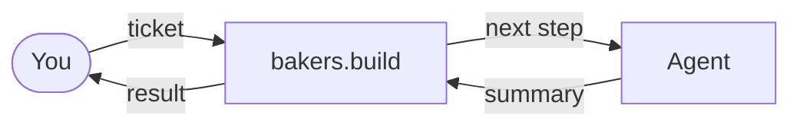

# What is bakers.build

**bakers.build lets AI agents work your tickets, step by step, while you stay in charge.**

You describe the work as a ticket. Agents take each step: plan, build, review. After every step they leave a summary and move the ticket on. You read the summary, answer questions and decide.

bakers.build does not care which agent, which terminal or which stack you use. Those are [addons](/addons/) you can swap; the tickets stay the same.

## The building blocks

| Term | Meaning |
|---|---|
| Workspace | Your team's space with its people and projects |
| Project | One repository in bakers.build |
| Ticket | One piece of work with its state, comments and history |
| State | The current step of a ticket, such as `plan`, `working` or `review` |
| Skill | Instructions that tell the agent how to do a step |
| `WORKFLOW.md` | The file in your repository that picks the skills and checks |
| Conductor | The worker that picks up tickets and starts agents |

[Skills & Workflows](/skills-and-workflows/) explains states and workflows in detail.

## Next

[Set up bakers.build →](/get-started/install)
